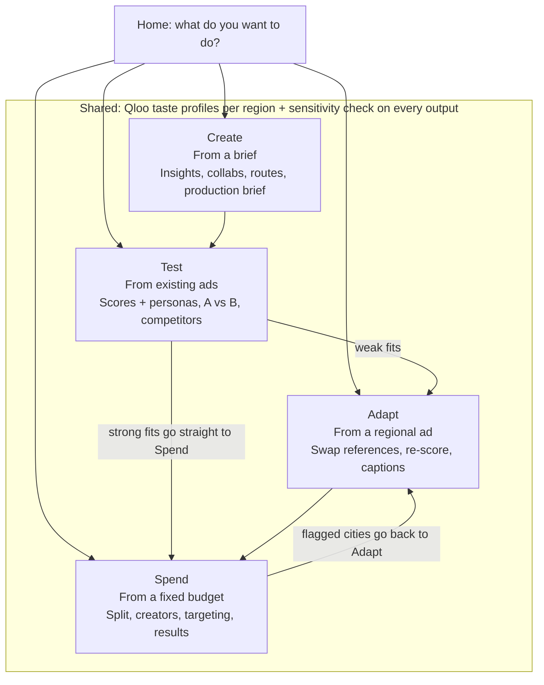
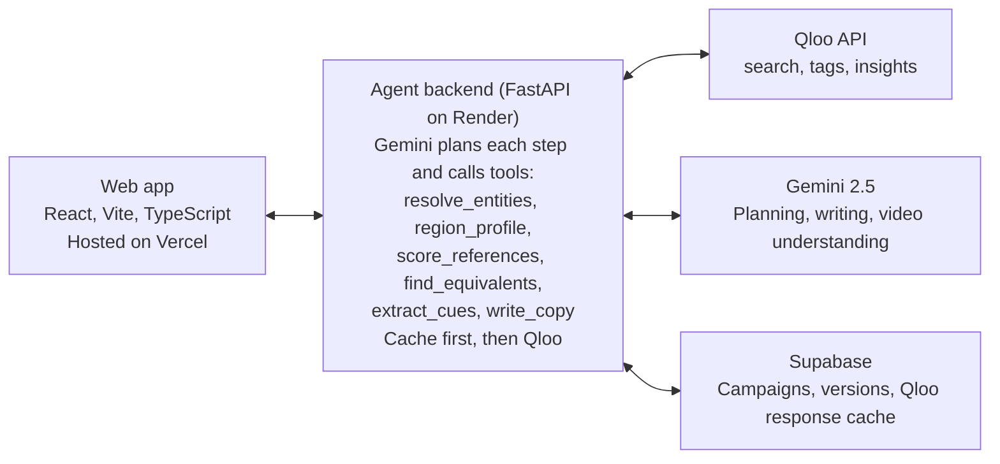

# Action AI — Build Plan

Oct 16, 2026 · @Suhaan Aneja

## Overview

Action AI is a cultural strategist agent for ad teams: it takes a campaign from brief to region-ready versions, using Qloo's taste graph at every step. It tells a team what each region's audience is into, generates creative routes grounded in that data, pre-tests their own scripts, videos and Instagram/Facebook creatives for regional fit, transcreates a finished ad for another region by swapping cultural references with their closest local equivalents, and tells them how to split a limited ad budget across regions.

**One-liner:** Know which version of your ad fits which region, and where your budget will work hardest, before you spend a rupee on media.

**Who it is for:** brand managers, agency strategists (planners), copywriters, art directors and the production team; the whole group that turns a brief into a shot ad and its regional versions.

**Name.** Action AI is a working name, chosen to be self-explanatory for judges; the final name can be settled after the build.

## The hackathon

Action AI is the entry for the **Qloo Agentic Hackathon** on Devpost ("Agents, but with taste"), due **31 Oct 2026, 9:15 AM IST**. The prize pool is $25,000 in cash ($15K / $6K / $4K), and Jason Calacanis will personally invest another $25K in his favourite entry.

**The one rule that matters:** if the project would work the same without Qloo, it is the wrong project. Qloo's taste data must be the reason the agent beats a plain LLM.

**What to submit**

- A live, externally hosted demo judges can use end to end (no local-only builds; no video required)
- A public GitHub repo with all source, assets and run instructions
- A text description of what the agent does and what makes it Qloo-powered
- An open-source license, visible in the repo's About section

**Judging criteria**

| Criterion | What judges ask |
| --- | --- |
| Technological implementation | How deep and non-trivial is the Qloo usage? |
| Design | Is it a complete product, not a proof of concept? |
| Potential impact | Is there a credible, specific case for a real audience? |
| Quality of the idea | Is it a non-obvious use of Qloo, by a team that understands the space? |

**Judges:** Jason Calacanis (investor), Mike Diolosa (Qloo CTO), Nicole Seligman (OpenAI board), Todd Boehly (Eldridge), Cedric the Entertainer, and Michael Abrams (Live Nation). The panel leans business and entertainment, so the product story matters as much as the engineering.

**What won last time.** Qloo's first hackathon (2025) had about 2,850 participants and 344 submissions. The winners were GeoTaste (where to open a business), Alloy (cultural compatibility in M&A), Resonance AI (culturally tuned political messaging) and Zesty (an "unrecommendation" engine). Generic travel, movie and "cultural DNA" recommenders did not place. [Project gallery](https://qloo-hackathon.devpost.com/project-gallery)

## How we got here

Seven ideas were tested against one question: is Qloo the product, or decoration on it? Only the last one passed.

| Idea | What it was | Why it was dropped |
| --- | --- | --- |
| Whisper + Qloo | Taste as a second matching signal and icebreaker in the peer-support app, collected as "comfort picks" | Whisper's value is lived-experience matching; Qloo was a garnish, so it fails the without-Qloo test |
| HeyDoc recovery agent | Diet plans that respect clinical restrictions and the patient's own cuisine | Qloo listed a near-identical idea (meals for seniors), so it scores low on originality |
| HR vibe check | Score candidates' culture fit and team match from their taste | Taste is a proxy for age, region, religion, class and gender, so it discriminates by design; no evidence taste predicts productivity; high legal risk (EU AI Act, NYC bias audits) |
| Dementia reminiscence agent | Expand a few known tastes into personalised reminiscence sessions | Still "input preferences, get recommendations": a personalisation engine with a new user |
| Clinical trial recruitment / health campaign localiser | Taste as channel intelligence for reaching a population | Last year's winners (GeoTaste, Resonance) restructured |
| Cultural reference localiser | Swap a script's references for the local equivalent in another market | Kept, and folded into Action AI as its transcreation engine |
| **Action AI** | The full ad-team workflow, brief to regional versions | **Chosen** |

**The lesson that shaped Action AI:** Qloo's output should be evidence the agent uses to make a decision, not the thing the user receives. In Action AI, Qloo never recommends anything to an end consumer. It tells an ad team whether a creative fits a region and what to change.

## The problem

Ads are made for one audience and then stretched to fit others, and the stretch is where they go flat. In India, a pan-India ad built on Punjabi wedding references, Bollywood music and Delhi street food often lands poorly in Chennai or Kolkata. Regional versions are usually just translations, because finding the right local equivalent of every reference is slow and depends on one writer's gut.

The insight step is gut-driven too. Strategists hunt for a true, slightly surprising thing about the audience, but rarely have cross-domain data on what that audience actually loves across music, film, food and brands.

**How an ad gets made**

1. **Brief.** The brand states the product, goal, audience, budget and constraints.
2. **Strategy.** A planner finds the insight the ad will stand on. This is the most valuable step and the least data-driven.
3. **Creative routes.** Copywriter and art-director pairs turn the insight into 2–3 distinct concepts, each with a script or storyboard.
4. **Client presentation.** One route is picked and refined.
5. **Pre-production.** Casting, locations, wardrobe, music and set design.
6. **Pre-testing.** Big brands test scripts or rough cuts on audience panels before buying media (firms like Kantar and System1 sell this).
7. **Shoot and post-production.**
8. **Adaptation.** The hero ad is transcreated for regions and languages.

Action AI adds Qloo-grounded intelligence to steps 2, 3, 5, 6 and 8, and makes steps 6 and 8 fast enough to run on every idea, not just the final cut.

## The product

Action AI ships seven core modules that follow the ad-making workflow, a four-module digital ads layer, and five strategy and safety modules, all reading from one shared regional taste profile. Regions are modelled as cities (Delhi, Lucknow, Chennai, Bengaluru, Kolkata, Mumbai to start), since Qloo's location signal works by city.

| # | Module | Ad-making stage | What the team gets | Qloo's role |
| --- | --- | --- | --- | --- |
| 1 | Brief intake | Brief | A structured brief: product, category, goal, target age and gender, regions, tone, budget tier | Resolves the brand and competitors to Qloo entities |
| 2 | Regional insight cards | Strategy | Per region: top artists, films, TV, brands, places and taste tags for the target audience, plus 3 written insights the ad could stand on | Core: audience + location insights across entity types |
| 3 | Creative route generator | Creative routes | 3 concept routes per region, each with a hook, a one-paragraph script and the insight it stands on | Grounds every route in the region's taste profile, not stereotypes |
| 4 | Script fit check (pre-test A/B) | Pre-testing | Paste 2+ scripts; get a fit score per region, the references that help or hurt, and suggested fixes | Compares each script's references against the region's profile |
| 5 | Video fit check (pre-test A/B) | Pre-testing | Upload 2 cuts; a vision model extracts music, setting, wardrobe, references and casting cues, then the same fit scoring runs | Same as module 4, with video as input |
| 6 | Transcreation | Adaptation | Pick source and target region; every reference is swapped for its closest local equivalent, each swap explained, accept or reject per line | Core: finds the entity holding the same cultural slot in the target region |
| 7 | Production brief | Pre-production | Music direction, locations, wardrobe, props and set dressing that will land in the region | Cross-domain coherence across music, fashion, places and brands |

### Digital ads layer (Instagram, Facebook, Reels)

The digital layer extends Action AI from making the ad to placing it: every format Meta runs, and a planner that decides where a limited budget goes. It reuses the same regional profiles and fit scores, so it adds little new plumbing.

| # | Module | What the team gets | Qloo's role |
| --- | --- | --- | --- |
| 8 | Creative fit check for all formats | Module 5 extended to static images, carousels, Reels and Stories: a vision model reads the visuals, on-image text, caption and hashtags, then the same regional scoring runs | Scores each extracted reference against each region |
| 9 | Budget and region planner | Enter a total budget, candidate regions and 1+ creatives; get a recommended split per region and per creative, a ranked list of where each creative fits best, and a "fix before you spend" flag for big regions where the creative fits badly | Fit scores per creative per region are the core input |
| 10 | Targeting pack | Per region: suggested interests to try in Meta's detailed targeting (artists, shows, brands that region's audience loves), plus localised captions and hashtags | Region's top entities become interest suggestions; transcreation localises the copy |
| 11 | Results loop (stretch) | Upload a Meta Ads Manager CSV export after launch; compare predicted fit with real CTR and cost per result by region, and suggest how to shift budget | Re-runs fit scoring to explain which regions over- or under-performed |

**How the planner decides.** Each region gets a score: creative fit × audience size × (1 ÷ cost). Fit comes from Qloo. Audience size defaults to a built-in table of city population for the target age band, and the team can override it with Meta's own estimated reach. Cost is optional: if the team knows their typical CPM per city, they enter it. Budget is split in proportion to the score, with a minimum test share (10%) per region so every region gets enough spend to learn from.

**What it never claims.** Qloo does not know ad prices or conversion rates, so the planner never promises "most effective" or a ROAS number. It recommends a **starting split** based on cultural fit, and says to shift budget after 3–5 days of real results (which module 11 helps with).

**Why this is not GeoTaste again.** GeoTaste answered "where should this business go?" Action AI answers "where will *this specific creative* land, and should I fix it before spending there?" The planner is creative-aware, and the fix-before-spend flag links straight into transcreation.

### Strategy and safety modules

Five more modules deepen the pipelines: four lean hard on Qloo, and one is a safety gate that runs on everything Action AI writes. None needs a new pipeline; each slots into an existing step.

| # | Module | Pipeline and step | What the team gets | Qloo's role |
| --- | --- | --- | --- | --- |
| 12 | Brand collab finder | Create, after insight cards | Brands, films, artists and events the target audience in each region already loves, turned into 3 co-branding or tie-in ideas (e.g. a chai brand × a regional film release); routes can build on a chosen collab | Core: brand, film and artist affinity for the region and audience, excluding the brand and its competitors |
| 13 | Persona panel | Test, beside the fit score (also on Adapt re-scores) | 3–4 regional personas, each built from a real taste cluster, reacting to the creative in one or two sentences, labelled as simulated | Core: each persona is a Qloo taste cluster (tags and top entities for an age and gender band in that city) |
| 14 | Competitor ad check | Test, as an input option | Paste or upload a competitor's ad (from Meta's public Ad Library); see its fit by region next to yours, and the cities where it fits weakly, so you know where to push | Same fit scoring as module 8 |
| 15 | Creator matcher | Spend, after the budget split | For each region getting meaningful spend: public figures, artists and actors whose audience overlaps the brand's target audience, as candidates for creator or celebrity partnerships | Core: person entities ranked by affinity to the region, brand and audience. Covers well-known people, not micro-influencers |
| 16 | Sensitivity check (guardrail) | Runs automatically on Create routes, Test results and every Adapt swap | Flags references that could backfire in a region: religious imagery, regional or language rivalries, caste references, political symbols, festival misuse. Each flag says why and suggests a safer option; a flagged swap cannot be accepted without a human override | Small: Gemini with a curated regional sensitivity list does most of the work; Qloo context helps judge how a reference reads locally |

**The sensitivity check never auto-approves.** It reduces risk; it does not certify an ad as safe. The UI says so, and every override is logged in the campaign.

**A note on wording.** Modules 4 and 5 are **pre-testing**, not A/B testing. Real A/B testing needs real audiences and clicks. Action AI gives an explained prediction before media spend. The pitch says "know which version fits before you spend," never "replaces A/B tests," because an ad person on the panel would knock that down.

**Shared across modules**

- **Campaign workspace:** every brief, route, script and version saved per campaign in Supabase
- **Explainability:** every score and every swap shows the Qloo entities and tags behind it
- **Human in the loop:** nothing auto-publishes; the team approves each route and each swap
- **Export:** a campaign summary (insights, chosen route, regional versions, production brief) as PDF

## Users and pipelines

The sixteen modules are packaged as four pipelines, each starting from a question a user already has: Create, Test, Adapt and Spend. Users pick a pipeline from the home screen, run it alone, or chain it into the next; all four read the same cached regional taste profile.

Create hands its routes to Test; weak fits in Test go to Adapt and strong ones go straight to Spend; Spend sends flagged cities back to Adapt.

### Who it is for

| User | Who they are | The question they bring | Pipelines |
| --- | --- | --- | --- |
| **Brand manager (primary)** | Owns a D2C brand's campaigns and budget; often runs Meta ads in-house | Will this ad work in each city, and where should I spend? | Test, Adapt, Spend |
| Agency strategist and creatives | Planner, copywriter and art director turning a brief into concepts | What insight and which routes will land in each region? | Create, Test |
| Localisation team | Adapts a hero ad for other regions and languages | How do I make this work in Chennai without just translating it? | Adapt |
| Performance marketer | Buys media and runs targeting | How do I split ₹X across cities and creatives, and who do I target? | Spend |
| Production team | Producer, stylist, music supervisor | What music, locations and wardrobe will land here? | Create (production brief) |
| Small business owner | No team; boosts posts on Instagram | Is my post right for my city, and where should I boost it? | Test, Spend (simple mode) |

The hackathon demo is built around the brand manager, because one person can believably run all four pipelines on a single campaign.

### The four pipelines

| Pipeline | Starts from | Steps | Choices the user makes | Hands off to |
| --- | --- | --- | --- | --- |
| **Create** | "I have a brief" | Brief → insight cards → collab finder → creative routes → sensitivity check → pick a route → production brief → export | One region or several side by side; how many routes; build a route on a collab or not; include the production brief or not | Test |
| **Test** (pre-test) | "I already have ads" (mine or a competitor's) | Upload creatives → extract references → fit score per region → persona panel → sensitivity check → what helps, what hurts, suggested fixes | Format (script, video, image, carousel, Reel + caption); one creative across many regions, A vs B in one region, or mine vs a competitor's | Adapt for weak fits; Spend for winners |
| **Adapt** | "My ad works in one region; I need it in others" | Source and target regions → line-by-line transcreation → sensitivity check on every swap → accept or reject → re-score with persona panel → localised captions and hashtags | Script only or the full creative; which target regions; add a reshoot production brief | Test (re-check) or Spend |
| **Spend** | "I'm ready to run ads on a fixed budget" | Creatives + budget + cities → fit matrix → recommended split → fix-before-spend flags → creator matcher → targeting pack → launch → results loop | Automatic split or set own caps per city; which creatives; enter reach and CPM or use defaults; include creator candidates or not | Adapt for flagged cities |

### Which modules each pipeline uses

| Module | Create | Test | Adapt | Spend |
| --- | --- | --- | --- | --- |
| 1 Brief intake | Yes | Light | Light | Light |
| 2 Regional insight cards (shared engine) | Yes | Yes | Yes | Yes |
| 3 Creative route generator | Yes |  |  |  |
| 4, 5, 8 Fit check (script, video, every format) |  | Yes | Re-score | Yes |
| 6 Transcreation |  |  | Yes |  |
| 7 Production brief | Yes |  | Optional |  |
| 9 Budget and region planner |  |  |  | Yes |
| 10 Targeting pack |  |  | Captions | Yes |
| 11 Results loop |  |  |  | Yes |
| 12 Brand collab finder | Yes |  |  |  |
| 13 Persona panel |  | Yes | Re-score |  |
| 14 Competitor ad check |  | Yes |  |  |
| 15 Creator matcher |  |  |  | Yes |
| 16 Sensitivity check | Routes | Yes | Every swap |  |

"Light" brief intake means only product, audience and regions, so a user can start testing in under a minute.

## Qloo integration

Action AI uses four Qloo endpoints on the hackathon host `https://hackathon.api.qloo.com`, authenticated with the `X-Api-Key` header. The endpoint shapes below come from other hackathon builders' public tools, not Qloo's own docs (they block automated reads), so confirm each against the [developer guide](https://docs.qloo.com/reference/qloo-llm-hackathon-developer-guide) on day 1.

| Endpoint | Purpose | Used by |
| --- | --- | --- |
| `GET /search` | Resolve a name (brand, artist, film, place) to a Qloo entity ID | Brief intake, script and video fit check, transcreation |
| `GET /v2/tags` | Resolve a genre, style or keyword to a tag ID | Insight cards, route generator |
| `GET /v2/audiences` | List audience segments | Insight cards (optional refinement) |
| `GET /v2/insights` | Taste-based results of one entity type from entity, tag, age, gender, audience and location signals | Every module |

**Key parameters on `/v2/insights`**

- `filter.type`: the entity type to return, e.g. `urn:entity:artist`, `urn:entity:movie`, `urn:entity:tv_show`, `urn:entity:brand`, `urn:entity:place`, `urn:entity:person`, `urn:entity:book`, `urn:entity:podcast`
- `filter.type=urn:tag`: returns the taste tags that describe an entity set, audience or location
- `filter.type=urn:demographics`: returns the age and gender affinity of an entity or tag
- `signal.location.query` (or `signal.location` as a POINT with `signal.location.radius`): the city as the taste signal
- `signal.interests.entities` and `signal.interests.tags`: seeds such as the brand and its category
- `signal.demographics.age` and `signal.demographics.gender`: the target audience
- `filter.results.entities`: score specific entities (e.g. a script's references) against the signal
- `filter.location.query`: restrict places to a city

**Call recipes per module**

1. **Insight cards:** for each region and each of 5 entity types, call `/v2/insights` with `signal.location.query=<city>`, the target demographics and the brand as `signal.interests.entities`. Add one `filter.type=urn:tag` call for the region's taste tags. About 6 calls per region, run in parallel and cached.
2. **Fit check (script or video):** extract references with Gemini, resolve each through `/search`, then call `/v2/insights` with `signal.location.query=<region>` and `filter.results.entities=<the references>`. The affinity of each reference in that region becomes its score; the weighted mean is the script's fit score.
3. **Transcreation:** for each source reference, get its tags and demographic profile (`urn:tag`, `urn:demographics`). Then call `/v2/insights` for the same entity type with `signal.location.query=<target region>`, `signal.interests.tags=<the source's tags>` and the source's demographics. The top results are candidate equivalents; Gemini picks the best one for the line and explains why.
4. **Production brief:** `/v2/insights` per region for artists (music direction), brands and fashion tags (wardrobe), and places (locations).

**Recipes for the digital ads layer**

- **Any format (module 8):** Gemini vision reads the image, carousel frames or Reel; the caption and hashtags are parsed as text. The references then go through the same fit-check recipe.
- **Budget planner (module 9):** run the fit-check recipe once per creative per region, so 3 creatives × 6 regions is 18 cached scoring calls. The planner itself is plain arithmetic in the backend; no extra Qloo calls.
- **Targeting pack (module 10):** reuse the region's insight-card results. The top artists, TV shows, films and brands become suggested Meta interests, and the team checks each exists in Ads Manager before using it.

**Recipes for the strategy and safety modules**

- **Collab finder (module 12):** `/v2/insights` with `filter.type` set to brand, movie, artist and tv\_show in turn, `signal.location.query=<city>`, the target demographics and the brand as `signal.interests.entities`, with `filter.exclude.entities` removing the brand and its competitors. Try `bias.trends=high` to surface timely tie-ins such as an upcoming film. Gemini turns the top results into 3 collab ideas.
- **Persona panel (module 13):** for one city, call `filter.type=urn:tag` and a top-entities call for 3–4 age and gender bands. Each band's tags and top entities become one persona card. Gemini voices that persona's reaction using only those entities, and the card shows them so the reaction is traceable.
- **Competitor ad check (module 14):** the fit-check recipe, run on the competitor's creative.
- **Creator matcher (module 15):** `/v2/insights` with `filter.type=urn:entity:person`, `signal.location.query=<city>`, the target demographics and the brand plus the region's top entities as `signal.interests.entities`.
- **Sensitivity check (module 16):** mostly Gemini, prompted with a curated list of sensitive categories per region kept in the repo. Qloo results for the region give context on how a reference reads locally.

**The day-1 validation test.** Before building anything, run the insight-card recipe for 3 categories (chai, a sneaker brand, a bank) across Delhi, Lucknow, Chennai and Bengaluru. If Delhi and Chennai come back clearly different, the product stands. If they look alike, switch the demo to markets with stronger contrast (e.g. US cities, or India vs US) and present Indian regions as the next step.

## Architecture and tech stack

Action AI is one web app talking to one agent backend, which calls Qloo for taste evidence, Gemini for planning and writing, and Supabase for storage. The stack reuses what you already shipped Whisper and HeyDoc with, so day 1 is wiring, not learning.

The agent never writes a claim without Qloo evidence behind it: every route, score and swap carries the entity and tag IDs it came from.

| Layer | Choice | Why |
| --- | --- | --- |
| Frontend | React, Vite, TypeScript, Tailwind on Vercel | Your Whisper stack; free hosting with a public URL |
| Backend | Python FastAPI on Render | Easy parallel Qloo calls (httpx + asyncio); hides API keys |
| Agent | Gemini 2.5 with function calling | Gemini plans the steps and calls Qloo tools; video understanding for module 5 |
| Storage | Supabase (Postgres + storage bucket) | Campaigns, versions, uploaded videos, and the Qloo response cache |
| License | MIT | Meets the open-source rule |

**How the agent works on a transcreation request**

1. Extract every cultural reference from the script, with its type (brand, artist, food, place, film).
2. Resolve each through `resolve_entities`; flag any that Qloo cannot find for manual handling.
3. For each reference, get its tags and demographic profile, then call `find_equivalents` in the target region.
4. Pick the best candidate for the line's context, rewrite the line, and attach the evidence.
5. Re-score the new script with `score_references` and show before and after.

## Demo script

The demo is a fictional chai brand, "Kadak Co.", launching in Delhi and Chennai; a judge should see Qloo change the answer within 60 seconds. Ship it preloaded as a sample campaign so judges can click through without typing.

1. **Brief (10 s).** Kadak Co., premium packaged chai, ages 22–35, Delhi and Chennai, warm and nostalgic tone.
2. **Insight cards (15 s).** Delhi and Chennai side by side: different artists, films, foods and brands. Each card ends with a written insight, e.g. "Chennai's profile leans on filter-coffee culture, so chai has to earn its place."
3. **Script fit check (15 s).** Paste the Delhi script: a Punjabi wedding, a Diljit-style track, Old Delhi street snacks. It scores high for Delhi and low for Chennai, with the three references that drag it down highlighted.
4. **Transcreation (15 s).** One click to Chennai: the wedding becomes a temple-festival morning, the track takes an Anirudh-style feel, the snacks become a local tiffin. Each swap shows the Qloo entities and tags behind it, and the re-scored version lands high.
5. **Production brief (5 s).** Music direction, locations and wardrobe for the Chennai shoot.
6. **Video fit check (optional, 15 s).** Two short sample cuts uploaded; the one that fits Chennai wins, with reasons.

**Digital add-on (20 s).** Kadak Co. has ₹2 lakh for an Instagram push across six cities and two creatives: the Delhi Reel and the transcreated Chennai Reel. The planner gives each creative its strongest cities, puts more spend where fit is high, and flags Kolkata: "large audience, weak fit for both creatives, transcreate before spending." One click sends Kolkata to transcreation, and the targeting pack lists the interests to try there.

**Moments from the new modules.** In Create, the collab finder suggests a tie-in with a film the Chennai audience is excited about. In Test, the persona panel shows a 24-year-old Chennai persona saying the Punjabi wedding "feels like someone else's festival." In Adapt, the sensitivity check flags one proposed swap that uses temple imagery in a way that could offend, and suggests a safer setting. In Spend, the creator matcher lists the public figures whose audience fits Kadak Co. in each top city.

**The closing line:** "Without Qloo, an LLM gives you stereotypes. With Qloo, every swap is backed by what that region actually loves."

## 7-day build plan

The full product is built in seven days, 17–23 Oct, leaving seven days of buffer before the 31 Oct deadline. Each day ends with something deployed, so a bad day never leaves you with nothing live.

**Day 1 — Fri 17 Oct: foundations and the validation test**

- [ ] Get the Qloo API key; confirm endpoints and parameters against the developer guide
- [ ] Run the validation test (3 categories × 4 cities); decide the demo regions
- [ ] Scaffold the repo: React + Vite + TypeScript + Tailwind frontend, FastAPI backend, Supabase project
- [ ] Write the Qloo client with caching (Supabase table keyed on the request)
- [ ] Deploy empty frontend to Vercel and backend to Render; add MIT license

**Day 2 — Sat 18 Oct: brief and insight cards**

- [ ] Brief intake form and campaign workspace (Supabase tables)
- [ ] Insight-card recipe: parallel Qloo calls per region, Gemini writes the 3 insights
- [ ] Side-by-side region view in the UI

**Day 3 — Sun 19 Oct: routes and script fit check**

- [ ] Route generator: 3 routes per region with the insight each stands on
- [ ] Reference extraction from scripts (Gemini, structured output)
- [ ] Fit scoring with `filter.results.entities`; highlight the references that help or hurt

**Day 4 — Mon 20 Oct: transcreation and production brief**

- [ ] Transcreation agent: tags and demographics of each reference, target-region search, Gemini picks and explains
- [ ] Line-by-line accept or reject UI; re-score the new version
- [ ] Production brief module
- [ ] Sensitivity check: curated regional list, Gemini check on every swap, block accept until a human overrides, log overrides

**Day 5 — Tue 21 Oct: video, polish and the sample campaign**

- [ ] Video fit check: upload, Gemini video understanding extracts cues, same scoring
- [ ] Preload the Kadak Co. sample campaign and sample video cuts
- [ ] PDF export; loading states; error handling when Qloo returns little
- [ ] README with setup steps, architecture and the Qloo explanation

**Day 6 — Wed 22 Oct: digital ads layer**

- [ ] Extend the fit check to images, carousels, Reels and captions
- [ ] Budget and region planner: score matrix, split with a 10% minimum per region, fix-before-spend flag linking to transcreation
- [ ] City population table for default audience sizes; override fields for reach and CPM
- [ ] Targeting pack: interest suggestions and localised captions per region
- [ ] Results loop from a Meta CSV export, only if the day ends early

**Day 7 — Thu 23 Oct: strategy modules**

- [ ] Collab finder in Create, with routes able to build on a chosen collab
- [ ] Persona panel in Test and on Adapt re-scores
- [ ] Competitor ad check as an input option in Test
- [ ] Creator matcher in Spend
- [ ] Run the sensitivity check on Create routes and Test results too

**Buffer — 24–30 Oct**

- [ ] Fresh-eyes test with 2–3 people outside the project (ideally someone from marketing or an agency)
- [ ] Fix what they trip on; tune prompts on weak swaps
- [ ] Write the Devpost description; check every submission requirement
- [ ] Submit by 29 Oct, not on the last night

## Risks, guardrails and judging fit

The biggest risk is data, not code: everything depends on Qloo telling Indian cities apart clearly.

| Risk | Likelihood | Fallback |
| --- | --- | --- |
| Qloo's India data is thin or cities look alike | Medium | Demo on markets with sharp contrast; pitch India as the next market |
| Scope: sixteen modules in seven days | High | Build in the plan's order; cut in this order if days slip: results loop, competitor check, video fit check, targeting pack, creator matcher. The sensitivity check is never cut |
| Gemini mis-extracts references from scripts, images or video | Medium | Show the extracted list and let the team edit it before scoring |
| Hackathon API rate limits | Unknown | Cache every Qloo response; preload the sample campaign |
| Judges read it as a generic marketing tool (like 2025's Marketly) | Medium | Lead the demo with transcreation and fit scores, where Qloo is visibly doing the work |
| Budget planner read as GeoTaste again | Medium | Show it as creative-aware: same cities, different splits for different creatives, plus the fix-before-spend flag |
| Planner over-promises performance | Medium | Call it a starting split; no ROAS or "most effective" claims; point to the results loop |
| Persona panel read as real people's opinions | Medium | Label every persona as simulated and show the Qloo entities behind it |
| Creator matcher expected to find micro-influencers | Medium | Say clearly it covers public figures and artists Qloo knows, not small creators |
| Sensitivity check misses something | Medium | Present it as an assistant, not a certification; human approval stays mandatory |

**Guardrails**

- **Stereotyping:** regional ads can slide into caricature. Every insight and swap cites the Qloo data behind it, and the team approves each one; Action AI never invents a regional trait the data does not show.
- **No individuals:** Action AI works only on aggregate regional taste. It never profiles a named person, which keeps it clear of the problems that sank the HR idea. The creator matcher only ranks public figures by their public audience overlap, never private individuals.
- **Honest claims:** fit scores are predictions to guide a team, labelled as pre-testing, not proof of performance. The same goes for budget splits: they are a starting point based on cultural fit, not a forecast of returns.

**Against the judging criteria**

| Criterion | Action AI's case |
| --- | --- |
| Technological implementation | Four endpoints, a multi-step agent, and Qloo in every module; transcreation chains tag, demographic and location calls |
| Design | A full workflow from brief to export, with a preloaded campaign judges can click through |
| Potential impact | A real industry with a known pain: regional versions of Indian ads that are only translated |
| Quality of the idea | Uses taste for cultural equivalence across regions, a use no 2025 winner touched |

## Submission checklist and open questions

- [ ] Live demo URL works logged out, on desktop and phone
- [ ] Sample campaign preloaded so judges need no setup
- [ ] Public GitHub repo with README: setup, env variables, architecture, how Qloo is used
- [ ] MIT license file, visible in the repo's About section
- [ ] Devpost text description: problem, modules, and a clear "why it needs Qloo" paragraph
- [ ] API keys stored as server environment variables, never in the repo
- [ ] Submitted by 29 Oct

**Open questions**

- Solo build or with a teammate?
- Which demo regions, once the validation test is in?
- Does the hackathon key allow enough calls for judges to run fresh campaigns, or should non-sample campaigns be rate-limited?
- Is there an agency or brand contact who could give a quote or feedback for the impact story?
